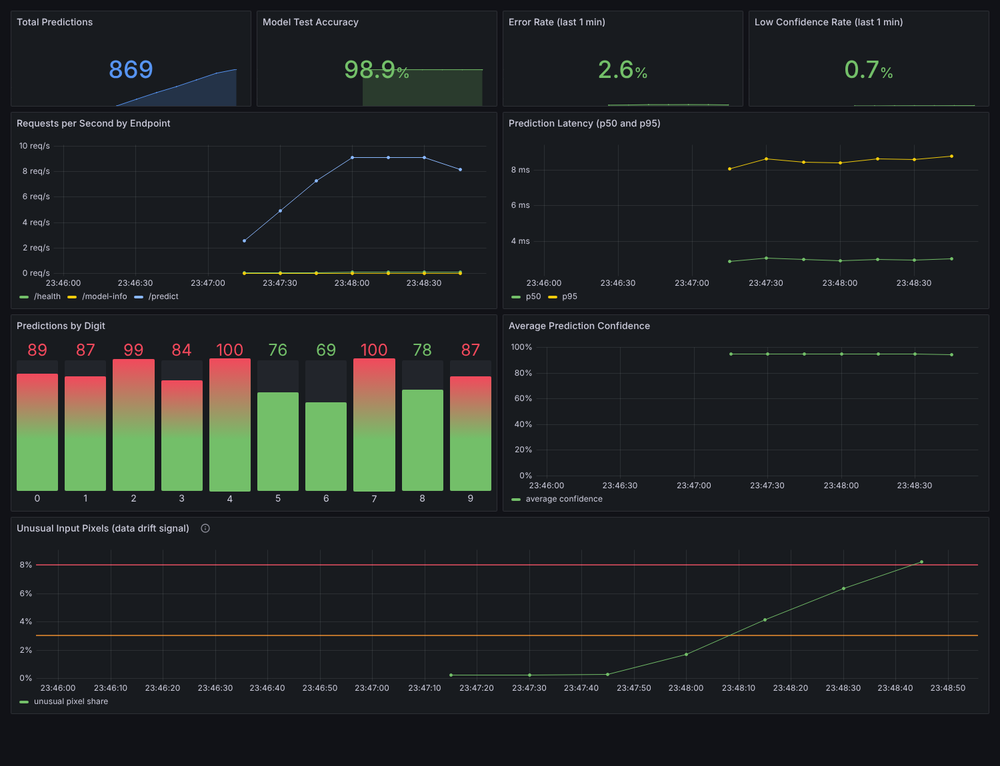

# Model Watchtower

A containerized machine learning service with live production monitoring. A handwritten digit classifier is served through FastAPI, while Prometheus collects metrics from every request and Grafana displays them on a live dashboard. The whole stack starts with one command using Docker Compose.



## What It Does
* **Serves a model:** an SVC classifier with calibrated probabilities recognizes digits 0 to 9 from 8x8 grayscale images (about 97% test accuracy).
* **Tracks every request:** request counts, status codes and response times for each endpoint.
* **Monitors model behavior:** predictions per digit, the confidence of each prediction, and how often confidence falls below 60%.
* **Shows it live:** a Grafana dashboard that refreshes every 5 seconds.
* **Simulates real traffic:** a traffic generator can send normal requests, invalid requests and distorted images, to show how the dashboard reacts when incoming data changes.

## Architecture

| Container | Role | Address |
|-----------|------|---------|
| `digit-api` | FastAPI app serving the model and exposing metrics at `/metrics` | http://localhost:8000 |
| `prometheus` | Collects metrics from the API every 5 seconds | http://localhost:9090 |
| `grafana` | Displays the monitoring dashboard | http://localhost:3000 |

The Docker image is built in three stages: one installs the dependencies, one trains the model, and the final one contains only the app and the trained model. It runs as a non root user and includes a health check.

## Prerequisites
* [Docker Desktop](https://www.docker.com/products/docker-desktop/), installed and running
* Git
* Python 3.10 or newer (only needed to run the tests outside Docker)

## Installation

```bash
git clone https://github.com/arckived/model-watchtower.git
cd model-watchtower
```

## Running the App

### 1. Start all containers

```bash
docker compose up --build -d
```

The first build takes a few minutes. The model is trained during the build, so the API is ready as soon as the container starts.

### 2. Check that everything is running

```bash
docker compose ps
```

All three containers should be `Up`, and `digit-api` should be `(healthy)`.

### 3. Open the services

* **API docs:** http://localhost:8000/docs
* **Prometheus targets:** http://localhost:9090/targets (`digit-api` should show **UP**)
* **Grafana dashboard:** http://localhost:3000 (opens automatically; log in with `admin` / `admin` to edit)

### 4. Make a prediction

In the API docs, call **GET /sample** to get a random digit image, then paste its `pixels` into **POST /predict**. Or from the command line:

```bash
curl -X POST http://localhost:8000/predict \
  -H "Content-Type: application/json" \
  -d '{"pixels": [0,0,5,13,9,1,0,0,0,0,13,15,10,15,5,0,0,3,15,2,0,11,8,0,0,4,12,0,0,8,8,0,0,5,8,0,0,9,8,0,0,4,11,0,1,12,7,0,0,2,14,5,10,12,0,0,0,0,6,13,10,0,0,0]}'
```

Example response:

```json
{"digit": 0, "confidence": 0.98, "low_confidence": false}
```

### 5. Generate traffic for the dashboard

Normal traffic:

```bash
docker compose exec api python -m app.traffic --requests 300
```

Traffic where 70% of the images are distorted, to simulate a change in incoming data:

```bash
docker compose exec api python -m app.traffic --requests 300 --noise 0.7
```

During the distorted run, the Low Confidence Rate rises and the Average Prediction Confidence drops on the dashboard.

| Option | Default | Description |
|--------|---------|-------------|
| `--requests` | 200 | Number of requests to send |
| `--delay` | 0.1 | Seconds between requests |
| `--noise` | 0.0 | Share of images to distort (0 to 1) |
| `--error-rate` | 0.05 | Share of invalid requests (0 to 1) |

### 6. Stop the containers

```bash
docker compose down
```

To also delete the stored metrics history, use `docker compose down -v`.

## API Endpoints

| Method | Endpoint | Description |
|--------|----------|-------------|
| GET | `/` | Service information |
| GET | `/health` | Health check used by Docker |
| GET | `/model-info` | Model accuracy, F1 score and dataset details |
| GET | `/sample` | A random digit image with its true label |
| POST | `/predict` | Predict the digit for one image |
| POST | `/predict-batch` | Predict digits for up to 100 images |
| GET | `/metrics` | Metrics in Prometheus format |

Each image is a list of 64 numbers (an 8x8 image, row by row), each from 0 (blank) to 16 (dark).

| Code | Meaning |
|------|---------|
| 400 | Batch is empty or has more than 100 images |
| 422 | Wrong number of pixels, or a value outside 0 to 16 |
| 503 | The model has not been trained |

## Dashboard Panels

| Panel | What it shows |
|-------|---------------|
| Total Predictions | All predictions made since the API started |
| Model Test Accuracy | Accuracy of the loaded model on the test set |
| Error Rate | Share of requests that failed in the last minute |
| Low Confidence Rate | Share of predictions below 60% confidence in the last minute |
| Requests per Second | Traffic per endpoint |
| Prediction Latency | Median (p50) and 95th percentile (p95) response time |
| Predictions by Digit | How many times each digit was predicted |
| Average Prediction Confidence | How sure the model is, on average |

## Running the Tests

The tests run outside Docker, in a Python virtual environment:

```bash
python3 -m venv venv
source venv/bin/activate
pip install -r requirements-dev.txt
pytest -v
```

On Windows, activate the environment with `venv\Scripts\activate`. The output should end with `10 passed`. The tests check model training, every endpoint, input validation and the metrics output.

## Continuous Integration
The GitHub Actions workflow (`.github/workflows/ci.yml`) runs on every push and pull request to `main`, in two jobs:
1. **unit-tests:** installs the dependencies and runs the test suite.
2. **docker-stack:** builds the image, starts all three containers, waits for the API health check, sends test traffic, and checks that the API exposes metrics, Prometheus is collecting them and Grafana is running.

## Project Structure

```
model-watchtower/
├── .github/workflows/ci.yml          CI workflow
├── app/
│   ├── main.py                       FastAPI app and Prometheus metrics
│   ├── train.py                      Model training and evaluation
│   └── traffic.py                    Traffic generator
├── grafana/
│   ├── dashboards/                   Dashboard definition
│   └── provisioning/                 Data source and dashboard setup
├── prometheus/prometheus.yml         Prometheus configuration
├── tests/test_app.py                 Tests
├── assets/                           Screenshots
├── Dockerfile                        Multi stage image build
├── docker-compose.yml                Runs all three containers
├── requirements.txt                  App dependencies
├── requirements-dev.txt              Test dependencies
└── pytest.ini                        Test settings
```

## Troubleshooting
* **`Cannot connect to the Docker daemon`:** open Docker Desktop and wait until it finishes starting.
* **`port is already allocated`:** another program is using port 8000, 9090 or 3000. Stop it, or change the left side of the port mapping in `docker-compose.yml` (for example `"8001:8000"`).
* **Grafana panels show "No data":** send traffic with the traffic generator, then wait about 10 seconds.
* **`digit-api` is not healthy:** check its logs with `docker compose logs api`.
* **`ModuleNotFoundError` when running tests:** run `pytest` from the project root folder with the virtual environment activated.
